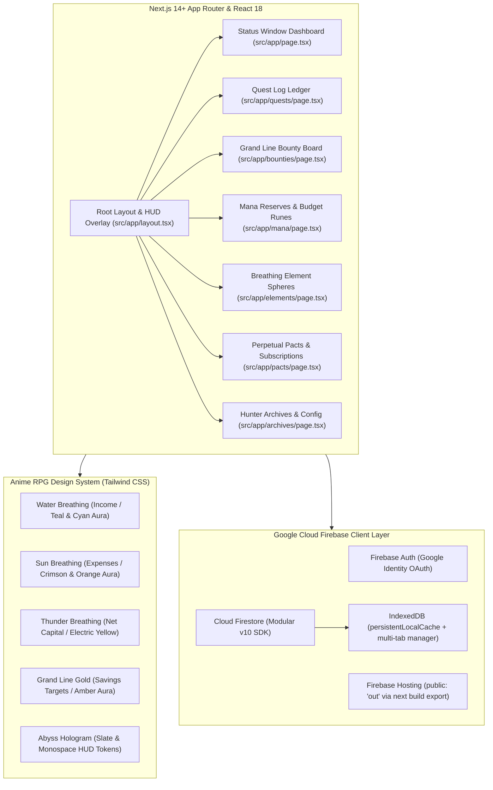

# Paisa Pulse — Technology Stack & Hunter System Architecture

Paisa Pulse is a next-generation personal financial command center and expense tracker redesigned with an **Anime RPG & Holographic Hunter System** aesthetic—drawing deep inspiration from *Solo Leveling's* Abyss System HUD, *Demon Slayer's* Elemental Breathing styles, and *One Piece's* Grand Line Wanted Bounties.

---

## 1. High-Level Architecture Overview



---

## 2. Core Technology Stack Breakdown

### A. Framework & Runtime
* **Framework**: **Next.js 14+ (App Router)**
  * **Static Export (`output: 'export'`)**: Generates optimized static HTML, JavaScript, and CSS in the `out/` folder for instant edge hosting on Firebase Hosting.
  * **App Directory Hierarchy**:
    * `src/app/page.tsx`: `/` — Hunter Status Window (Bento Box overview, net balance, 14-day velocity chart, spending spheres).
    * `src/app/quests/page.tsx`: `/quests` — Quest Log (transactions with elemental auras, filters, difficulty tiers).
    * `src/app/bounties/page.tsx`: `/bounties` — Wanted Posters (savings goals, golden aura pulse, gold deposits).
    * `src/app/mana/page.tsx`: `/mana` — Monthly budget runes, burn pace meters, rune enchanter.
    * `src/app/elements/page.tsx`: `/elements` — Breathing style category spheres.
    * `src/app/pacts/page.tsx`: `/pacts` — Recurring bills & scheduled dues.
    * `src/app/archives/page.tsx`: `/archives` — Google identity binding, CSV export, SMS decoder terminal.

### B. Language & Type Safety
* **Language**: **TypeScript (Strict Mode enabled)**
  * **Zero `any` Policy**: Full domain typing located in `src/types/hunter.ts`.
  * **Types**: `Transaction`, `Goal`, `BountyDeposit`, `Quest`, `ManaRune`, `CategorySphere`, `PerpetualPact`, `HunterStats`, `BreathingStyle`, `QuestDifficulty`, `HunterRankTier`.
  * **Ambient Typings (`src/types/ambient.d.ts`)**: Ambient declarations for React, Next.js, and Firebase guaranteeing zero language server resolution delays.

### C. Styling & Aesthetics
* **Engine**: **Tailwind CSS + PostCSS**
  * Custom theme tokens for:
    * `abyss-black`: `#020408`
    * `water-cyan`: `#00f2fe`
    * `sun-crimson`: `#ff2a5f`
    * `thunder-yellow`: `#ffe600`
    * `bounty-gold`: `#ffd700`
    * Glowing box-shadows: `shadow-glow-water`, `shadow-glow-sun`, `shadow-glow-thunder`, `shadow-glow-bounty`, `shadow-glow-system`.
    * RPG typography: **Teko**, **Rajdhani**, and **Share Tech Mono** via Google Fonts.

### D. Data & Storage Layer
* **Database**: **Google Cloud Firestore (Modular v10 SDK)**
  * Multi-tab offline persistence using `persistentLocalCache({ tabManager: persistentMultipleTabManager() })`.
  * Real-time listeners (`onSnapshot`) for multi-device live synchronization.
* **Authentication**: **Firebase Auth** with Google Sign-In popups and session listeners.
* **Banking SMS Parser**: Regular expression engine tuned for Indian banks (HDFC, SBI, ICICI, Axis) and UPI alerts (Swiggy, Zomato, Uber, Zepto).
* **CSV Spoils Exporter**: UTF-8 BOM Excel-compatible statement exporter.

---

## 3. Directory Layout

```
expense tracker/
├── src/
│   ├── app/                    # Next.js App Router routes & pages
│   │   ├── archives/page.tsx   # System config, auth & export
│   │   ├── bounties/page.tsx   # Wanted posters & savings vaults
│   │   ├── elements/page.tsx   # Breathing categories
│   │   ├── mana/page.tsx       # Monthly budget runes
│   │   ├── pacts/page.tsx      # Recurring dues
│   │   ├── quests/page.tsx     # Transaction ledger
│   │   ├── globals.css         # Theme styles & scanline overlays
│   │   ├── layout.tsx          # Master layout with HUD
│   │   └── page.tsx            # Main Status Window
│   ├── components/             # Reusable React components
│   │   ├── finance/            # StatusWindow, QuestLog, BountyBoard
│   │   ├── layout/             # StatusLayout with HUD breadcrumbs & vitals
│   │   ├── modals/             # QuestModal, BountyModal
│   │   └── ui/                 # StatusCard primitive
│   ├── lib/                    # Typed utility libraries
│   │   ├── auth.ts             # Google OAuth & session observer
│   │   ├── export.ts           # Excel UTF-8 BOM CSV exporter
│   │   ├── firebase.ts         # Firebase singleton & multi-tab cache
│   │   ├── firestore.ts        # Typed CRUD & real-time listeners
│   │   ├── mockData.ts         # High-fidelity Hunter mock data
│   │   ├── smsParser.ts        # Bank/UPI SMS regex decoder
│   │   └── utils.ts            # Currency formatter & rank evaluator
│   └── types/                  # Strict TypeScript definitions
│       ├── ambient.d.ts        # Ambient module declarations
│       └── hunter.ts           # Domain models
├── public/                     # Static assets (PWA manifest, icons)
├── firebase.json               # Configured for public: 'out'
├── next.config.mjs             # Next.js static export config
├── package.json                # Dependencies & npm scripts
├── tailwind.config.ts          # Anime RPG color tokens & animations
└── tsconfig.json               # Path alias and compiler settings
```

---

## 4. Decommissioning & Cleanup of Legacy Code

All vanilla JavaScript files in `js/`, static HTML files (`index.html`, `app.html`), and old service workers (`sw.js`) have been superseded. 

To permanently delete all legacy files, execute the following PowerShell command in the project root:

```powershell
Remove-Item -Recurse -Force js, data, icons, app.html, index.html, styles.css, sw.js, manifest.json
```
